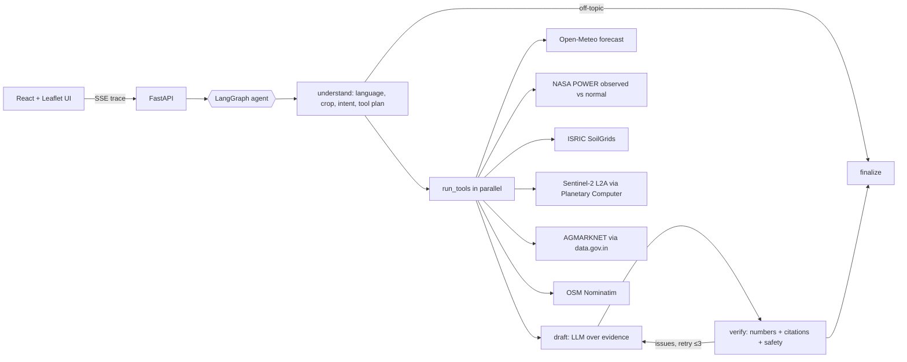

# 🌾 KhetSaathi: field-level, verifiable farm copilot

**Forge '26 · Theme 2: Climate, Resource Infrastructure & Global Supply Resilience**
(Multilingual Agritech Advisory + Micro-Location climate risk)

A farmer marks their plot on a satellite map and asks a question in their own language.
A LangGraph agent plans which live data it needs, calls the tools in parallel (satellite NDVI for *that plot*, a 16-day
forecast, rain vs the 30-year normal, soil, mandi prices), drafts an answer, and passes it through a
**deterministic verifier** that rejects any number or citation not grounded in the fetched data. The UI streams the
whole reasoning trace live, and every claim in the answer links to its source and fetch time.

## Why it's different
| Generic advisory bots (incl. Bharat-VISTAAR) | KhetSaathi |
|---|---|
| District or state level | **Your plot**: Sentinel-2 NDVI over your polygon, soil at your point |
| Reactive Q&A | Planned multi-tool reasoning + proactive risk alerts (roadmap) |
| Unverifiable text | **Every number is checked against tool output; citation chips with timestamps** |
| Hindi / English | Any Indian language (LLM + Sarvam voice) |

## Architecture


### Live data sources (no mock data anywhere)
| Tool | Source | Key? |
|---|---|---|
| `weather_forecast` | [Open-Meteo](https://open-meteo.com/en/docs) (ECMWF/GFS blend), IMD rain categories | no |
| `climate_anomaly` | [NASA POWER](https://power.larc.nasa.gov/docs/services/api/) daily + 30-yr climatology | no |
| `soil_profile` | [ISRIC SoilGrids 2.0](https://www.isric.org/explore/soilgrids) | no |
| `crop_ndvi` | [Sentinel-2 L2A](https://planetarycomputer.microsoft.com/dataset/sentinel-2-l2a), SCL cloud mask, windowed COG reads | no |
| `mandi_prices` | [AGMARKNET daily prices on data.gov.in](https://data.gov.in/resource/current-daily-price-various-commodities-various-markets-mandi) | free key |
| `location` | [OSM Nominatim](https://nominatim.org/) | no |

Resilience: every call has a timeout and retries; results are cached on disk; if a live call fails the last good
copy is served **labelled as stale**, and if nothing is available the agent says the data is unavailable rather than guessing.

## Run locally
```bash
# backend
cd backend
python3 -m venv .venv && .venv/bin/pip install -r requirements.txt
cp .env.example .env   # add an LLM key (+ DATA_GOV_API_KEY for mandi prices)
.venv/bin/uvicorn app.main:app --reload --port 8000

# frontend (new terminal)
cd frontend
npm install
npm run dev            # http://localhost:5173
```

Checks:
```bash
cd backend
.venv/bin/python -m pytest -q                     # verifier unit tests
.venv/bin/python -m scripts.smoke_tools           # hits every live API once
```

## Repo layout
```
backend/app/tools/    live data tools (one file per source) + cache/retry plumbing
backend/app/agent/    LangGraph graph, prompts, LLM adapter, verifier
backend/app/main.py   FastAPI: /api/ask (SSE), /api/field/{tool}, /api/alerts/scan, /api/voice/*, /health
frontend/src/         React UI: map, field dashboard, chat with live trace
```
