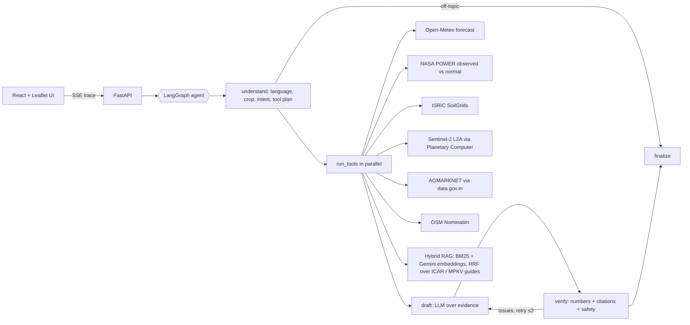

# 🌾 KhetSaathi: field-level, verifiable farm copilot

**Forge '26 · Theme 2: Climate, Resource Infrastructure & Global Supply Resilience**
(Multilingual Agritech Advisory + Micro-Location climate risk)

A farmer marks their plot on a satellite map and asks a question in their own language (typed or spoken).
A LangGraph agent plans which data it needs, calls the tools in parallel (satellite NDVI for *that plot*, a 16-day
forecast, rain vs the 30-year normal, soil, mandi prices, and official ICAR / MPKV onion guides via hybrid RAG),
drafts an answer, and passes it through a **deterministic verifier** that rejects any number, dose or citation not
grounded in the fetched data. The UI streams the whole reasoning trace live, and every claim links to its source,
fetch time and, for guides, the exact page.

## Why it's different
| Generic advisory bots (incl. Bharat-VISTAAR) | KhetSaathi |
|---|---|
| District or state level | **Your plot**: Sentinel-2 NDVI over your polygon, soil at your point |
| Reactive Q&A | Planned multi-tool reasoning + proactive risk alerts (roadmap) |
| Unverifiable text | **Every number is checked against tool output; citation chips with timestamps** |
| Model-memory pesticide advice | Doses only if copied from a cited ICAR/MPKV passage; banned pesticides always rejected |
| Hindi / English | Any Indian language (LLM + Sarvam voice) |

## Architecture


### Agent guardrails
- **Planner** (structured output) picks the minimal tool set; practice/treatment questions always pull official guides.
- **Verifier** (plain code, no LLM): every number must match tool data (Indic digits normalised); every `[T#]` tag must
  point to a successful tool; doses must be copied from a cited guide passage; banned pesticides are rejected; stray
  foreign-script characters are rejected. Failures loop back to the drafter with the exact issues (max 3 drafts).
- **Model fallback chain**: several Gemini models (and Claude/OpenAI if keys exist), 15 s timeouts; if every model is
  down, a deterministic data-only summary is returned instead of an error.
- **Off-topic** questions are refused without calling tools.

### Live data sources (no mock data anywhere)
| Tool | Source | Key? |
|---|---|---|
| `weather_forecast` | [Open-Meteo](https://open-meteo.com/en/docs) (ECMWF/GFS blend), IMD rain categories | no |
| `climate_anomaly` | [NASA POWER](https://power.larc.nasa.gov/docs/services/api/) daily + 30-yr climatology | no |
| `soil_profile` | [ISRIC SoilGrids 2.0](https://www.isric.org/explore/soilgrids) | no |
| `crop_ndvi` | [Sentinel-2 L2A](https://planetarycomputer.microsoft.com/dataset/sentinel-2-l2a), SCL cloud mask, windowed COG reads | no |
| `mandi_prices` | [AGMARKNET daily prices on data.gov.in](https://data.gov.in/resource/current-daily-price-various-commodities-various-markets-mandi) | free key |
| `location` | [OSM Nominatim](https://nominatim.org/) | no |
| `agronomy_docs` | ICAR *Indian Horticulture* ([kharif 2021](https://epubs.icar.org.in/index.php/IndHort/article/view/115081), [rabi 2023](https://epubs.icar.org.in/index.php/IndHort/article/view/116816)), [MPKV Rahuri onion storage 2026](https://mpkv.ac.in/Uploads/Research/20260819_123631_cf1ef5e78c9a27a5306bb5e2b55d4eb4.pdf); index built by `scripts/build_rag_index.py` | Gemini (embeddings) |

Resilience: every call has a timeout and retries; results are cached on disk; if a live call fails the last good
copy is served **labelled as stale**, and if nothing is available the agent says the data is unavailable rather than guessing.

## Run locally
```bash
# backend
cd backend
python3 -m venv .venv && .venv/bin/pip install -r requirements.txt
cp .env.example .env   # add an LLM key (+ DATA_GOV_API_KEY for mandi prices)
.venv/bin/uvicorn app.main:app --reload --port 8000

# frontend (new terminal)
cd frontend
npm install
npm run dev            # http://localhost:5173
```

Checks:
```bash
cd backend
.venv/bin/python -m pytest -q                     # verifier unit tests
.venv/bin/python -m scripts.smoke_tools           # hits every live API once
.venv/bin/python -m scripts.build_rag_index       # rebuild the guide index from sources.json
```

## Deploy (one container)
The root `Dockerfile` builds the React app and serves it from FastAPI on one port. On startup the server pre-warms
caches for the demo field so the first visit is instant.
```bash
docker build -t khetsaathi .
docker run -p 7860:7860 --env-file backend/.env khetsaathi   # http://localhost:7860
```
- **Render**: Dashboard → New → Blueprint → this repo (`render.yaml`), then paste the API keys when asked.
- **Hugging Face Docker Space** (needs PRO): `cd backend && .venv/bin/python -m scripts.deploy_hf`.

## Repo layout
```
backend/app/tools/    live data tools (one file per source) + cache/retry plumbing
backend/app/agent/    LangGraph graph, prompts, LLM adapter, verifier
backend/app/rag.py    hybrid retriever (BM25 + embeddings, RRF); data/rag/ holds sources + built index
backend/app/main.py   FastAPI: /api/ask (SSE), /api/field/{tool}, /api/alerts/scan, /api/voice/*, /health
frontend/src/         React UI: map, field dashboard, chat with live trace
```
